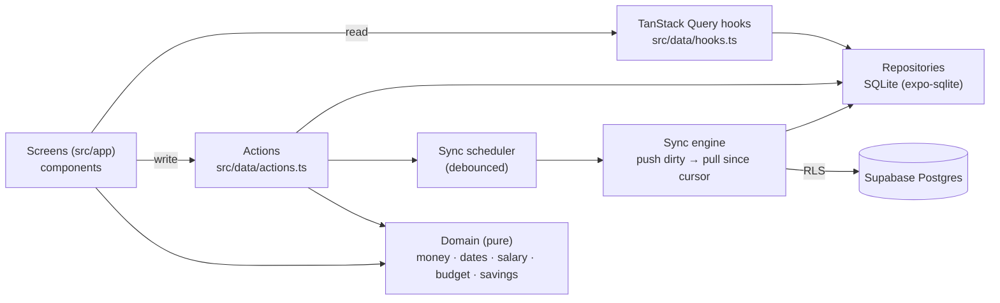

# Tally Architecture

## Layers

- **Domain** (`src/domain`): pure functions with no React or I/O, fully unit-tested. All money is
  integer minor units. All dates are local `YYYY-MM-DD` strings, and budget months are `YYYY-MM`.
- **Repositories** (`src/data/repositories.ts`): the only code that touches SQLite. Every write
  sets `dirty = 1` and a fresh `updated_at`.
- **Actions** (`src/data/actions.ts`): user intents (record a transaction, save a goal, finish
  onboarding). Each one writes locally, invalidates queries, and requests a sync.
- **Sync** (`src/data/sync.ts`): push dirty rows (upsert on `(user_id, id)`), then pull rows whose
  server `updated_at` is past the stored cursor. A local row with unpushed edits is never
  overwritten by a pull. Rows the server rejects (constraint errors) stay dirty without blocking
  the rest. Deletes are soft (`deleted_at`) so they propagate.

## Budget model

| Concept      | Rule                                                                                                                                                              |
| ------------ | ----------------------------------------------------------------------------------------------------------------------------------------------------------------- |
| Budget month | The calendar month of the date (Home shows "November 2026 · 1 – 30 NOV").                                                                                         |
| Salary date  | Last working day = last Mon–Fri. Custom = day of month, clamped (31 → 28/29/30).                                                                                  |
| Allocation   | `following_month`: the M−1 salary funds M (30 Oct → November). `same_month`: the M salary funds M.                                                                |
| Auto entries | Once per budget month, the app records a salary income and a savings contribution. IDs are SHA-256-derived from (user, kind, month), so offline devices converge. |
| Numbers      | spendable = income − savings · available = spendable − spent · % left = round(available / spendable).                                                             |

## Auth and routing

- Supabase Auth with `flowType: 'pkce'`: email/password, Google (system auth session), email
  confirmation and password reset links back to `tally://auth/callback` and `tally://auth/reset`.
- `src/app/_layout.tsx` uses `Stack.Protected` guards: signed out → `(auth)`, signed in but not
  onboarded → `(onboarding)`, onboarded → `(tabs)` and sheets. A guarded screen can't be reached,
  even by deep link. Blocked routes redirect to a real page (`/welcome`, `/personal-details` or `/`),
  because on web a group URL like `/(auth)` isn't one.
- On sign-in the app pulls from the server **before** choosing a route, so an existing user on a new
  device skips onboarding. With no local copy and no network, it shows a retry screen instead of
  onboarding (onboarding again could overwrite a real account).

## Platforms

Android, iOS and web share all code. Where a native module has no web build, a `*.web.ts(x)` file
next to it replaces it on web (Metro picks it; TypeScript and Jest see the native file):

| File                                            | Web behaviour                                        |
| ----------------------------------------------- | ---------------------------------------------------- |
| `src/lib/secure-session-storage.web.ts`         | Session in `localStorage` (no keychain in a browser) |
| `src/lib/notifications.web.ts`                  | No payday reminders (`remindersSupported = false`)   |
| `src/components/insights/expense-donut.web.tsx` | Loads Skia's CanvasKit, then the chart               |

Platform checks inside shared files: `src/lib/alert.ts` (browser `confirm()`, since react-native-web's
`Alert` does nothing), `src/lib/auth.ts` (Google sign-in redirects the tab), `src/data/db.ts` (no
exclusive transactions on web, and one tab at a time can hold the database).

## Security model

- Authorization lives in Postgres: RLS per table, composite keys and FKs scoped to the owner, CHECK
  constraints that mirror client validation, and minimal grants (`anon` gets nothing).
- Session storage: AES-256-GCM ciphertext in a SQLite key-value file, key in Keychain/Keystore
  (`WHEN_UNLOCKED_THIS_DEVICE_ONLY`). On web: plain `localStorage`, readable by any script on the
  origin, so the web build is for testing, and a public web deploy needs a CSP first.
- Avatars live in a private bucket under `<user id>/…` and are shown through 1-hour signed URLs.
- Sign-out revokes the session (falls back to local revocation offline) and wipes the local DB.

## Motion

Rules come from `REFERENCE/DOCS/animation-guidelines.md`. Tabs don't animate. Sheets are native
form sheets. Press feedback is a 0.97 scale as a Reanimated CSS transition. Progress bar and ring
animate only when their value changes. Haptics fire once per action, alongside the visual.
